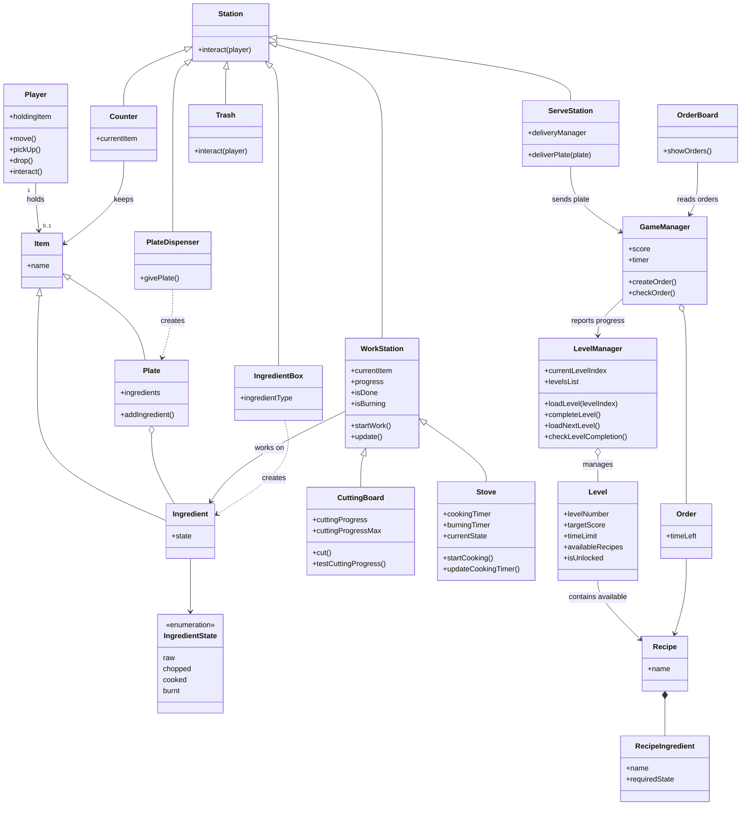
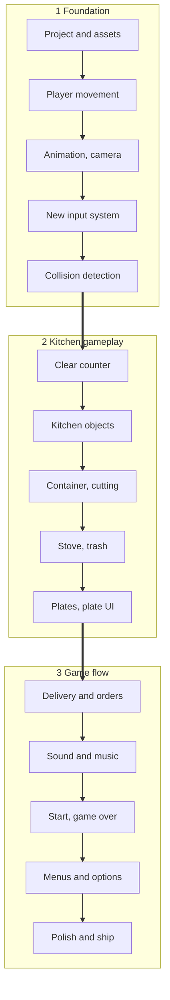

# Cooking Duck – 3D Cooking Simulation Game

A 3D arcade-style cooking simulation game built with **Unity** and **C#**, inspired by games like [Overcooked](https://en.wikipedia.org/wiki/Overcooked). This project demonstrates clean code architecture, decoupled game logic, and modern C# design patterns in Unity.

---

## 1. Technical Requirements & Architecture

### Objective

The primary goal is to build a fully functional, modular 3D game while adhering to production-level software engineering practices:

* Decoupling UI and visual presentation from underlying game logic using C# events and interfaces.
* Implementing robust design patterns (Singleton, State Machines, ScriptableObjects).
* Utilizing Unity's New Input System for flexible control handling and key rebinding.

### Storyline & Concept

You play as an ambitious chef rising through the ranks of the culinary world. Your goal is to work your way through a series of increasingly demanding kitchens, each presenting unique layout challenges, tighter time limits, higher target scores, and more complex menu recipes.

* Level Progression: Each level represents a new culinary challenge or restaurant venue. To clear a level and unlock the next stage, the player must meet or exceed a target score within the time limit by successfully fulfilling customer orders.

* Core Gameplay Loop: In every level, you must take incoming orders from the order queue, retrieve raw ingredients, process them at cooking and cutting workstations (e.g., slicing vegetables, frying meat to the correct cooked state), assemble completed meals onto plates, and deliver them to the service counter before time expires.

* Failing & Retrying: If you fail to reach the level's target score before the timer runs out, you must retry the level; clearing the target unlocks the next level with new recipes and faster-paced mechanics.

### Class Diagram Overview

### Flowchart Diagram

